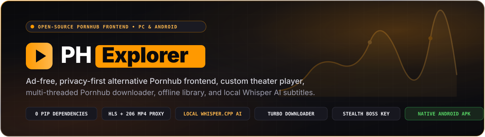
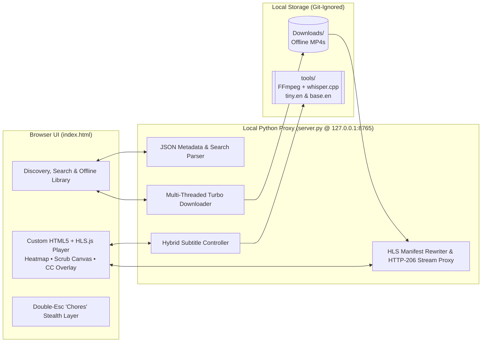

<div align="center">



<br />

[-Download%20ZIP-0078D4?style=for-the-badge&logo=windows&logoColor=white)](https://github.com/Ultron20U/PH-Explorer/releases/latest/download/PH-Explorer-Desktop.zip)
[](https://github.com/Ultron20U/PH-Explorer/releases/latest/download/PH-Explorer-Android.apk)
[](https://github.com/Ultron20U/PH-Explorer/releases/latest)
[](https://github.com/Ultron20U/PH-Explorer/stargazers)
[](#2-hybrid-subtitle-engine-official--local-ai)
[](LICENSE)

<p align="center">
  <b>An open-source, ad-free, privacy-first alternative <a href="https://www.pornhub.com">Pornhub</a> frontend, custom theater player &amp; multi-threaded Pornhub video downloader — for Windows, macOS, Linux, and Native Android.</b><br />
  Think <i>FreeTube</i> or <i>Invidious</i>, built specifically for Pornhub: zero ads, zero trackers, zero <code>npm</code> bloat, built-in fast MP4 downloading, offline library, and local Whisper AI subtitles.
</p>

<p align="center">
  <a href="https://github.com/Ultron20U/PH-Explorer/releases/latest/download/PH-Explorer-Desktop.zip"><b>💻 Download PC Edition (.zip)</b></a> •
  <a href="https://github.com/Ultron20U/PH-Explorer/releases/latest/download/PH-Explorer-Android.apk"><b>📱 Download Android APK</b></a> •
  <a href="#why-ph-explorer">Overview</a> •
  <a href="#feature-breakdown">Features</a> •
  <a href="#2-hybrid-subtitle-engine-official--local-ai">AI Subtitles</a> •
  <a href="#keyboard-shortcuts--touch-gestures">Controls</a>
</p>

</div>

---

## Why PH-Explorer?

Visiting **Pornhub** in a normal browser means dealing with aggressive ad scripts, popups, tracking pixels, a basic web player, and sketchy third-party "Pornhub downloader" websites riddled with malware.

**PH-Explorer** replaces the entire Pornhub web experience with a clean, self-hosted local proxy (`127.0.0.1`) and native Android app: browse regional Pornhub Hottest feeds, search videos/pornstars/channels, read nested comments with avatars & verified badges, stream 1080p ad-free, download MP4s at full speed with multi-threaded chunking, and generate **real-time English subtitles offline on your CPU**.

> [!TIP]
> **Zero External Python Dependencies:** The core application uses **100% Python standard library modules** (`http.server`, `urllib`, `concurrent.futures`, `threading`, `json`). If Python is installed on your machine, PH-Explorer runs immediately out of the box.

---

## Feature Breakdown

### 1. Custom Power-User Theater Player
Built from scratch on top of HTML5 `<video>` and `hls.js` for instant responsiveness:
- **Stream & Quality Control** — Switch seamlessly between `1080p`, `720p`, `480p`, and `240p` across both **HLS** adaptive streams and direct **HTTP-206 MP4** byte-range streams while preserving your exact playback timestamp.
- **Hold for `2×` Speed** — Hold down <kbd>Space</kbd> (or press-and-hold left-click anywhere on the video) for instant `2×` fast-forward; release to drop smoothly back to your normal speed.
- **Interactive Most-Replayed Heatmap & Scene Strip** — Renders the engagement curve directly above the timeline scrubber alongside clickable chapter & peak-moment pills.
- **Live Frame-Scrubbing Previews** — Hovering anywhere over the timeline renders real-time video frame thumbnails, chapter titles, and timestamps onto a dedicated `<canvas>`.
- **Precision Playback Tools** — **A–B segment repeat**, full-video looping, paused frame-by-frame stepping (<kbd>,</kbd> / <kbd>.</kbd>), `0.5×`–`2×` playback rates, **Theater Mode**, **Picture-in-Picture (PiP)**, and 1-click **PNG frame screenshot** capture.

### 2. Hybrid Subtitle Engine (Official + Local AI)
Toggle **CC** (or press <kbd>C</kbd>) on *any* streaming or downloaded video:
- **Instant Official & Hidden Captions** — Automatically inspects player metadata for official or unexposed closed-caption tracks (`SRT` / `VTT`), parses and sanitizes timestamps, and renders them immediately.
- **100% Offline Whisper AI Fallback** — When a video has no captions, the server extracts 24–30s audio slices (stitching fragmented MP4 `EXT-X-MAP` init headers automatically), decodes `16 kHz` mono PCM via `FFmpeg`, and runs quantized **`whisper.cpp`** inference locally on your CPU at `BELOW_NORMAL_PRIORITY` so video playback never stutters.
- **Lookahead Prefetching & Caching** — Automatically transcribes the upcoming audio window ahead of your playhead and caches transcribed windows in memory for instant re-seeking.
- **Four Selectable AI Profiles** — Switch anytime in the player settings menu between **`EN Fast`** (`tiny.en`), **`EN Accurate`** (`base.en`), **`Same Lang`** (99-language auto-detect in the original spoken language), and **`Any → EN`** (translates foreign speech directly into English subtitles).

### 3. Multi-Threaded Turbo Downloader & Offline Library
- **Parallel Range-Chunk Engine** — Splits MP4 files into concurrent HTTP `Range` segments across worker threads to saturate your connection, displaying live MB/s throughput, progress bars, and instant cancellation.
- **Built-In Offline Library** — Downloaded videos are indexed in `Downloads/downloads_index.json` and playable completely offline through the local `HTTP 206` range server—with full scrub preview and local AI subtitle support.

### 4. Full Discovery, Search & Performer Feeds
- **Regional & Global Feeds** — Browse *Hottest* videos in your auto-detected region, switch between 15+ countries (`US`, `GB`, `DE`, `FR`, `JP`, `BR`, `CA`, etc.), or view *Worldwide* trending feeds.
- **Dual-Mode Search & Live Autocomplete** — Instant client-side page filtering or full upstream search with sorting (`Featured`, `Most Viewed`, `Top Rated`, `Newest`, `Longest`), related query chips, and live search/pornstar autocomplete.
- **Dedicated Performer & Channel Profiles** — Click any pornstar, model, or channel badge to browse their full profile banner, avatar, verified status, stats, and sortable Pornhub catalog without leaving the app.
- **Threaded Comments with PFPs & Verified Badges** — Read Popular or Newest Pornhub comments and nested reply threads complete with user profile pictures, verified model/partner checkmarks, and clickable `mm:ss` timestamps.

### 5. Double-`Esc` *"Chores"* Boss-Key Stealth Mode
- Press <kbd>Esc</kbd> **twice rapidly** from anywhere in the app to instantly pause playback, mute media, swap the browser tab title, and replace the entire interface with a clean, interactive **Household Chores Checklist**.
- Press <kbd>Esc</kbd> **twice** again to return right where you left off.

---

## Architecture



---

## Android Native APK

Run the full PH-Explorer experience natively on any Android phone or tablet (Android 8.0+, `arm64-v8a` / `armeabi-v7a` / `x86_64`) — no PC required!

<p align="center">
  <a href="https://github.com/Ultron20U/PH-Explorer/releases/latest/download/PH-Explorer-Android.apk">
    
  </a>
</p>

- **Real Embedded Python Proxy (`Chaquopy`)** — Boots the exact same `server.py` locally inside the Android app on `127.0.0.1:8765`, blocking all ads, popups, and trackers before they ever reach the player.
- **Mobile Touch Gestures** — **Touch-and-hold** anywhere on the video for instant **`2×` speed** (with haptic feedback), **double-tap left/right** to seek **`±10s`**, drag your finger along the scrubber for live frame previews, and use Android's hardware **Back** gesture naturally.
- **Immersive Landscape Fullscreen & Native PiP** — Tapping Fullscreen rotates automatically into edge-to-edge immersive landscape while keeping custom heatmaps, `2×` speed badge, and `CC` subtitles intact; tapping **PiP** floats the video over other Android apps.
- **Turbo Downloader & Offline Library on Phone** — Multi-threaded downloads save to app storage with zero invasive storage permissions and play offline anytime.
- **Mobile Boss-Key Stealth Mode** — Tap the discreet **Checklist** icon in the top bar to switch instantly to the *Household Chores* screen; **double-tap** the *Household Chores* title to return.
- *(Note: Official & hidden closed captions (`CC`) work out of the box on Android; heavy CPU `whisper.cpp` AI transcription is a Desktop-only feature.)*

---

## Quick Start (Desktop)

### Prerequisites
- **Python 3.8 or newer** ([python.org](https://www.python.org/downloads/)) — *no `pip` packages required to run the core app!*

### Option A — 1-Click Desktop ZIP Download *(Recommended)*
1. Download **[PH-Explorer-Desktop.zip](https://github.com/Ultron20U/PH-Explorer/releases/latest/download/PH-Explorer-Desktop.zip)** and extract the folder.

### Option B — Clone with Git
```bash
git clone https://github.com/Ultron20U/PH-Explorer.git
cd PH-Explorer
```
*(Or click the green **Code → Download ZIP** button at the top of this page and extract the folder!)*

### Launch the Server
- **Windows:** Double-click **`start_server.bat`** *(or run `python server.py`)*
- **macOS / Linux:**
  ```bash
  chmod +x start.sh
  ./start.sh
  ```

Your browser will open automatically at **`http://127.0.0.1:8765`**.

> [!NOTE]
> Need a custom port? Set the `PORT` environment variable (e.g., `PORT=9000 python3 server.py`).

---

## Setting Up Local AI Subtitles *(Optional)*

Official closed captions work immediately with **zero extra setup**. To also enable **offline Whisper AI speech-to-text** (~90 MB download for quantized models + CPU runner):

- **Windows:** Double-click **`setup_ai.bat`** *(or run `python setup_ai.py`)*
- **Linux (x64):** Run `python3 setup_ai.py`
- **macOS:** Install the native binaries via Homebrew (`brew install whisper-cpp ffmpeg`), then run `python3 setup_ai.py` to grab the quantized models (`server.py` auto-detects system `ffmpeg` and `whisper-cli`).

Once installed:
1. Click **`CC`** in the bottom player bar (or press <kbd>C</kbd>).
2. Open the **Settings Badge (`HD` / `1080p`)** in the player bar to switch between **`Off`**, **`Pornhub`**, **`EN Fast`** (`tiny.en`), **`EN Accurate`**  (`base.en`),  **`Same Lang`**,  **`Any -> EN`**.

---

## Keyboard Shortcuts & Touch Gestures

### Mobile / Touchscreen Gestures
| Gesture | Action |
| :--- | :--- |
| **Touch & Hold on Video** | **Temporary `2×` Speed Boost** while held |
| **Single-Tap on Video** | Show / Hide Player Controls |
| **Double-Tap Left / Right / Center** | Rewind `-10s` / Skip `+10s` / Play-Pause |
| **Drag Timeline Bar** | Frame-accurate scrubbing with live preview |
| **Tap Top Checklist Icon** | Enter **"Chores" Boss-Key Stealth Mode** *(double-tap Chores title to exit)* |

### Desktop Keyboard Shortcuts

| Shortcut | Action |
| :--- | :--- |
| <kbd>Space</kbd> / <kbd>K</kbd> | Play / Pause |
| **Hold <kbd>Space</kbd>** *(or Hold Left-Click)* | **Temporary `2×` Speed Boost** while held |
| <kbd>C</kbd> | Toggle Subtitles (`CC`) On / Off |
| <kbd>Esc</kbd> × 2 *(double-tap)* | Toggle **"Chores" Boss-Key Stealth Mode** |
| <kbd>J</kbd> / <kbd>L</kbd> | Rewind `-10s` / Fast-Forward `+10s` |
| <kbd>←</kbd> / <kbd>→</kbd> | Seek `-5s` / `+5s` |
| <kbd>↑</kbd> / <kbd>↓</kbd> | Volume `+5%` / `-5%` |
| <kbd>M</kbd> | Mute / Unmute |
| <kbd>F</kbd> | Toggle Fullscreen *(or double-click center of video)* |
| <kbd>T</kbd> | Toggle Wide Theater Layout |
| <kbd>P</kbd> | Toggle Picture-in-Picture (PiP) |
| <kbd>,</kbd> / <kbd>.</kbd> | Step `-1` / `+1` Video Frame *(while paused)* |
| <kbd>0</kbd> – <kbd>9</kbd> | Jump to `0%` – `90%` of video duration |
| <kbd>?</kbd> | Open In-Player Shortcuts Overlay |

---

## Local API Reference

<details>
<summary><b>Click to expand all <code>server.py</code> endpoints</b></summary>

| Method | Endpoint | Description |
| :--- | :--- | :--- |
| `GET` | `/api/health` | Server health & status check |
| `GET` | `/api/hottest?cc=&page=1` | Regional or Worldwide (`cc=world`) hottest video feed |
| `GET` | `/api/search?q=&ordering=&page=1` | Upstream search (`featured`, `mostviewed`, `toprated`, `newest`, `longest`) |
| `GET` | `/api/autocomplete?q=` | Live search query & performer autocomplete suggestions |
| `GET` | `/api/performer?path=&name=&sort=&page=1` | Pornstar, model, or channel profile metadata & catalog |
| `GET` | `/api/video?id=` | Watch-page HLS/MP4 streams, hotspots, chapters, related & comments |
| `GET` | `/api/comments?vkey=&popular=&page=` | Paginated Popular / Newest video comments |
| `GET` | `/api/subs/ph?vkey=` | Extracts & normalizes official/hidden SRT/VTT closed captions to JSON cues |
| `GET` | `/api/subs/ai?vkey=&file=&start=&model=` | Transcribes a ~25–30s stream or local-file window via `whisper.cpp` |
| `GET` | `/api/hls?url=` | Same-origin `.m3u8` / `.ts` / `fMP4` proxy with automatic URI rewriting |
| `GET` | `/api/stream?url=` | `HTTP 206` byte-range CDN MP4 stream & direct download proxy |
| `GET` | `/api/thumb?url=` | Thumbnail image fallback proxy |
| `GET` | `/api/downloads` | Active multi-threaded download jobs + indexed Offline Library files |
| `POST` | `/api/downloads/start` | Starts a multi-threaded segmented MP4 download job |
| `POST` | `/api/downloads/cancel` | Cancels an in-progress download job |
| `POST` | `/api/downloads/delete` | Deletes a downloaded file from `Downloads/` |
| `GET` | `/api/local_video?file=` | `HTTP 206` byte-range streaming for local Offline Library MP4s |

</details>

---

## Project Layout

```text
PH-Explorer/
├── assets/
│   └── banner.svg     # Vector hero banner for documentation
├── index.html         # Complete single-file frontend UI, styles & custom video player
├── server.py          # Zero-dependency Python local proxy, scraper, downloader & AI runner
├── setup_ai.py        # Cross-platform installer for FFmpeg, whisper.cpp & quantized models
├── setup_ai.bat       # Windows 1-click AI subtitle installer
├── start_server.bat   # Windows 1-click server & browser launcher
├── start.sh           # macOS / Linux server & browser launcher
├── Downloads/         # (Auto-created, git-ignored) Offline MP4 library & JSON index
└── tools/             # (Auto-created, git-ignored) Local FFmpeg binary & Whisper models
```

---

## Disclaimer

> [!IMPORTANT]
> **Personal & Educational Use Only:** `PH-Explorer` is an independent, locally executed client interface and proxy. It is **not** affiliated with, endorsed by, or sponsored by any third-party website. This repository hosts and distributes **zero** media content. Users are solely responsible for complying with all applicable local laws, terms, and age restrictions in their jurisdiction.

## License

Distributed under the **[MIT License](LICENSE)**.
